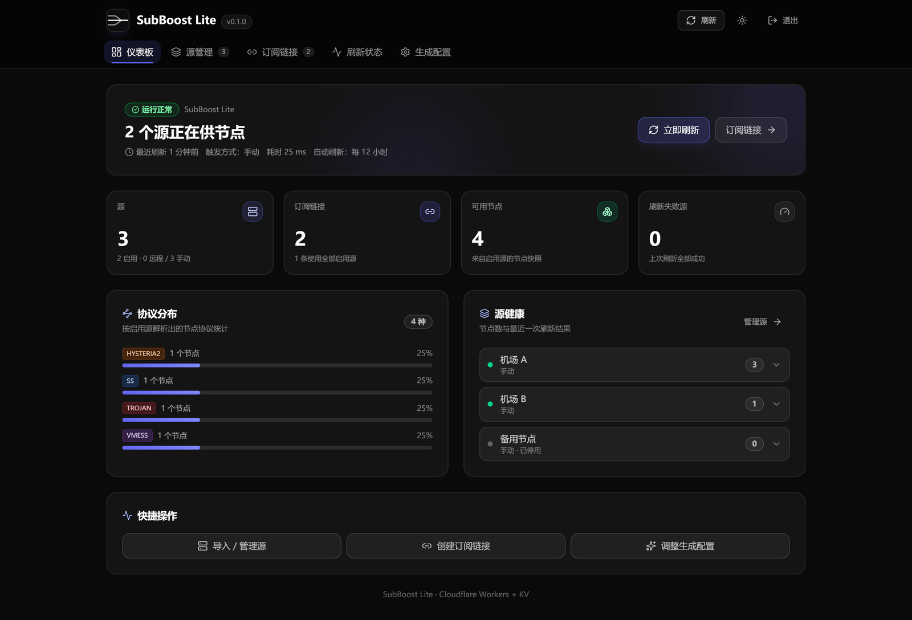
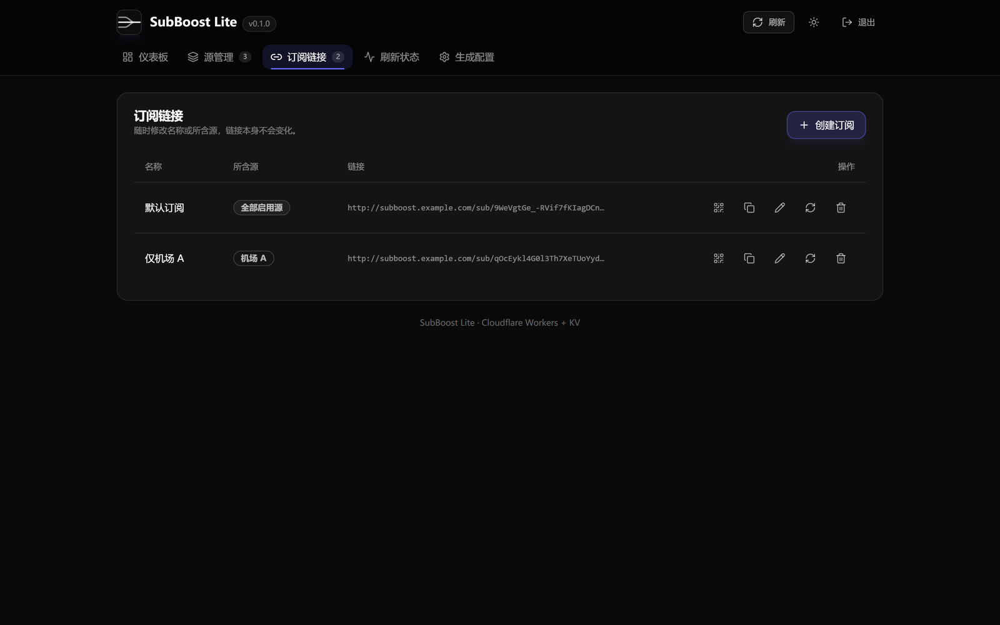
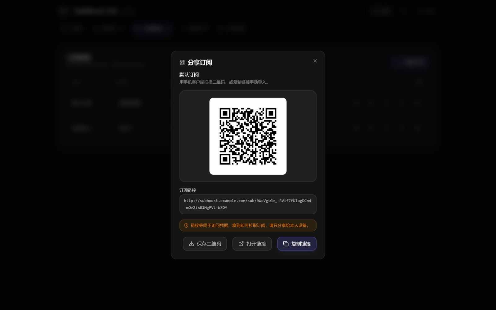
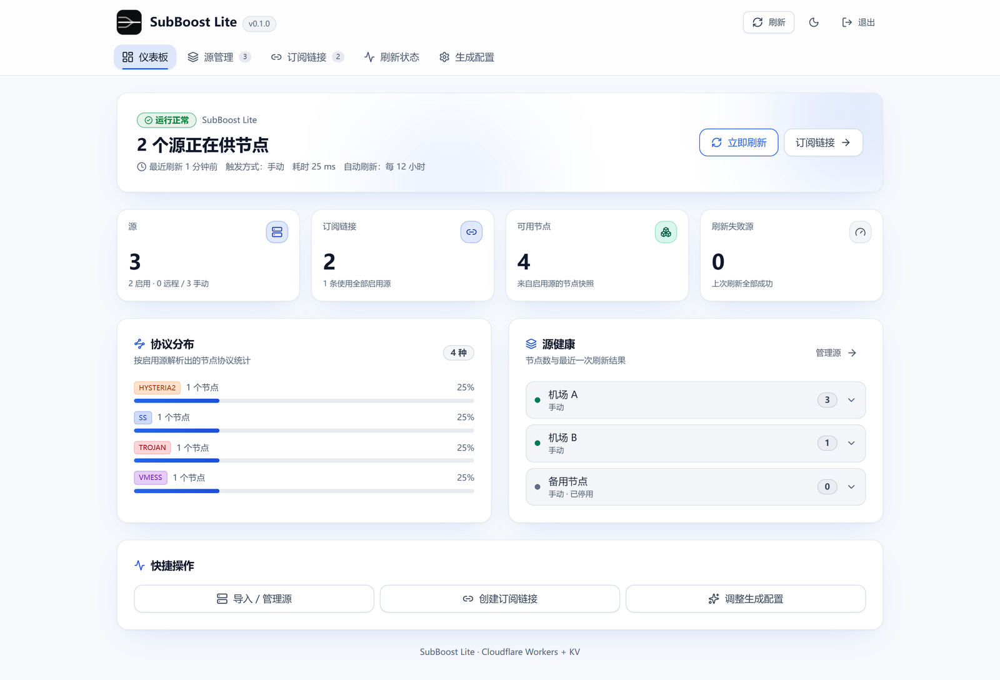
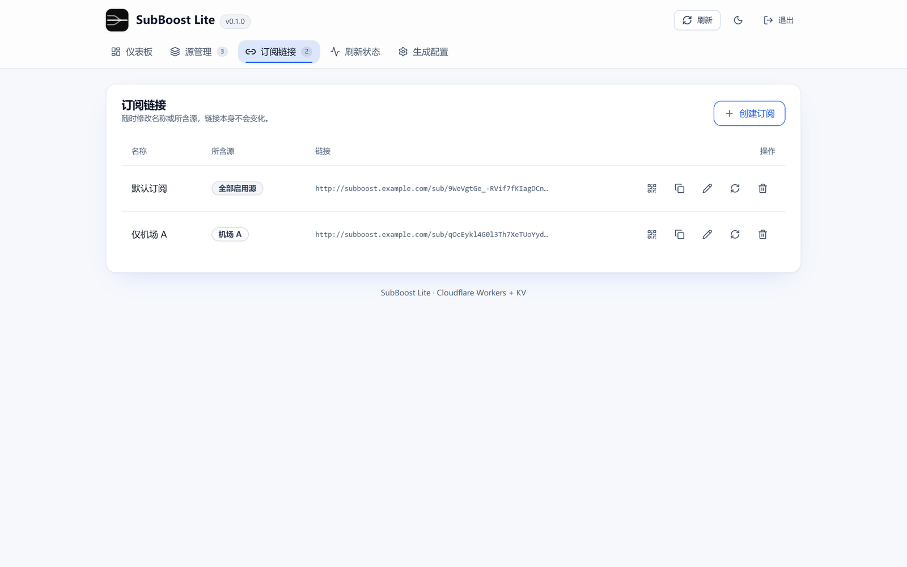
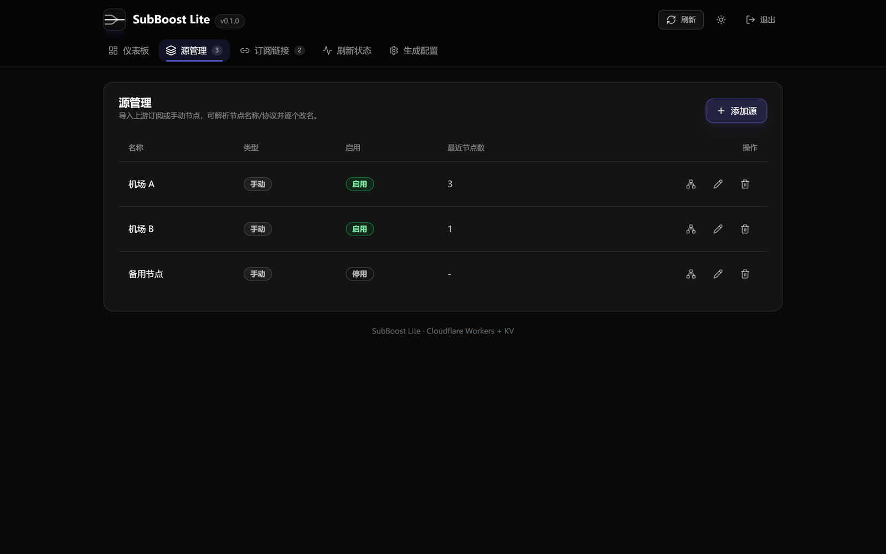

<!-- markdownlint-disable MD033 MD041 -->
<div align="center">
  <p></p>
  <h1>SubBoost Worker Lite</h1>
  <p>Cloudflare Workers + Workers KV 上的 Clash/Mihomo 订阅聚合与管理</p>
  <p>
    
    
    
  </p>
</div>
<!-- markdownlint-enable MD033 MD041 -->

**SubBoost Worker Lite** 是 [SubBoost](https://github.com/SubBoost/subboost) 的精简部署形态：把几个上游订阅与手动节点聚合成一条 Clash/Mihomo 订阅链接，只依赖 Cloudflare Workers 与 Workers KV，不需要服务器、数据库或容器。适合个人使用、只想维护一条聚合链接的场景。

## 界面预览

仪表板（深色）：



订阅链接与二维码分享（深色）：

| 订阅链接 | 二维码分享 |
| --- | --- |
|  |  |

仪表板与订阅链接（浅色）：

| 仪表板 | 订阅链接 |
| --- | --- |
|  |  |

源管理（深色）：



> 截图取自本地 `wrangler dev` 实例，使用示例源与保留域名（`example.com`、RFC 5737 网段）演示数据，不含任何真实订阅或凭据。

## 特性

- **订阅聚合**：导入多个上游订阅与手动节点（`ss://`、`vmess://`、`vless://`、`trojan://`、`hysteria2://` 等常见协议），跨源去重后生成一条订阅链接
- **管理端**：token 门保护的 SPA（源管理、订阅管理、刷新状态、生成配置 JSON 编辑），浅色/深色主题
- **扫码导入**：订阅链接可生成二维码，支持复制链接、保存 PNG 或直接打开，方便手机客户端导入
- **自动刷新**：Cron 每 12 小时抓取上游并预生成缓存，正常访问直接命中缓存
- **静态加密**：订阅 token 等敏感数据以 AES-256-GCM 静态加密存入 KV（HKDF-SHA256 派生密钥）
- **SSRF 防护**：协议/凭据校验、私网网段黑名单、重定向逐跳校验（最多 3 跳）
- **防泄漏**：全响应 `no-store`，错误与状态脱敏，订阅 token 可随时轮换

## 仓库结构

```
worker/       Cloudflare Worker（后端 API + 管理端 SPA + 部署配置）
packages/     共享包：core（解析/生成）、server-core（响应头与 UA）、ui（组件与主题）
docs/         实施文档（Plan/Build）与贡献指南
test/         回归测试与测试基础设施
```

## 一键部署（fork 本仓库）

<a href="https://deploy.workers.cloudflare.com/?url=https://github.com/G1oow/subboost"></a>

点按钮后用 GitHub 账号登录 Cloudflare：Cloudflare 会把本仓库复制到你自己的 GitHub 账号下（只复制，不改动上游仓库），新建一个名为 `subboost` 的 Worker。Workers Builds 复用根目录 `package.json` 的 `deploy` 脚本（`SUBBOOST_SKIP_SECRETS=1 npm run worker:deploy`），构建阶段由 `prepare` 自动生成管理页；`wrangler.jsonc` 里 KV namespace 只写了绑定名与占位符 id，Cloudflare 会按绑定名自动创建 KV 并替换配置里的 id。全程不需要手工建 KV，也不需要在本机登录 wrangler。

一键部署的**唯一手工步骤**是填两个运行时 Secret。按钮页面会启动部署，之后在 Worker 的 Settings → Variables and Secrets 里添加 Secret 类型的 `ADMIN_TOKEN` 与 `ENCRYPTION_KEY`（各 32 位以上随机串，生成命令见 **[worker/README.md](worker/README.md)**）；这两项没配置前，管理接口按 fail closed 返回 503。

不使用按钮、改为在自己 fork 出来的仓库里推送代码自动部署，或按钮部署后需要排错时，见 **[worker/README.md](worker/README.md)** 的「从 fork 仓库部署」章节。

## 本地开发与命令行部署

前置：Node 24.22.1+ 与 npm（版本见 `.nvmrc`，`nvm use` 可直接切换），本地运行不需要 Cloudflare 账号。

```bash
npm ci

# 1. 准备本地密钥（不要提交）
cp .dev.vars.example .dev.vars   # 填入随机 ADMIN_TOKEN、ENCRYPTION_KEY

# 2. 构建管理页
npm run worker:build

# 3. 启动（默认 http://127.0.0.1:8787）
npm run worker:dev
```

部署到 Cloudflare 只需一条命令，脚本会自动建好 KV namespace 并绑定，密钥通过环境变量传入、不写入仓库：

```bash
ADMIN_TOKEN=<32 位以上随机串> ENCRYPTION_KEY=<32 位以上随机串> npm run worker:deploy
```

脚本会按标题 `SUBBOOST_KV` 复用已存在的 KV namespace，找不到就新建，然后把 id 注入临时配置完成部署。CI 场景（Workers Builds、Deploy to Cloudflare 按钮）用根级 `npm run deploy`，它在此基础上跳过 Secret 上传，运行时密钥改在 Dashboard 配置；已有 `SUBBOOST_KV_ID=<id> SUBBOOST_SKIP_SECRETS=1 npm run worker:deploy` 这类显式指定 id 的命令效果等价，无需改动。上述方式的细节、fork 部署排错见 **[worker/README.md](worker/README.md)**。

## 常用命令

```bash
npm run worker:dev          # 本地运行 Worker
npm run worker:build        # 构建管理页到 worker/dist
npm run worker:deploy       # 构建 + 自动建/绑定 KV + 上传 Secret + 部署
npm run worker:deploy:dry-run  # 只校验配置与绑定，不上传
npm run worker:typecheck    # 类型检查
npm run lint                # ESLint + UI 一致性检查 + 仓库卫生检查
npm run test:unit           # 全量单元/回归测试
npm run test:coverage       # 带覆盖率阈值的质量门
```

## 文档

- 部署与运维手册：[worker/README.md](worker/README.md)
- 实施方案（Plan）：[docs/implementation/cf-worker-lite-plan.md](docs/implementation/cf-worker-lite-plan.md)
- 构建手册（Build，含冲突与验收记录）：[docs/implementation/cf-worker-lite-build.md](docs/implementation/cf-worker-lite-build.md)
- 贡献指南：[docs/CONTRIBUTING.md](docs/CONTRIBUTING.md)

## 与上游 SubBoost 的关系

本仓库派生自 [SubBoost/subboost](https://github.com/SubBoost/subboost)，只保留 Cloudflare Workers 精简形态所需的代码与测试；上游的 Next.js + PostgreSQL 自托管形态（`local/`）、Docker 发布管线等不在本仓库范围内。共享包（`packages/`）沿用上游实现，但只保留 Workers 形态实际引用到的模块，其余旧前端与 Node 服务端残留已移除。

## 许可证

[GNU Affero General Public License v3.0 only](./LICENSE)。

如果你修改本仓库并向网络用户提供服务，AGPL-3.0 要求你向这些用户提供对应的源代码。

## 免责声明

本项目不提供任何代理服务，不对第三方订阅内容的可用性与合法性作任何保证。
